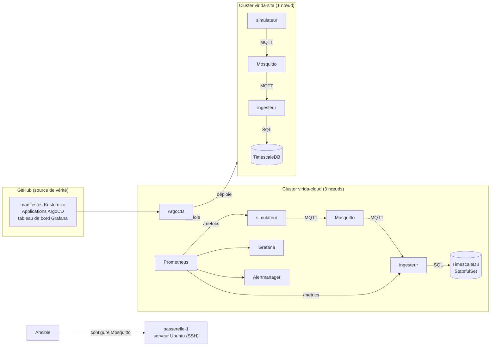

# Virida Fleet

Plateforme IoT de supervision de serres, déployée en **GitOps** sur deux clusters Kubernetes : un environnement **cloud** et un **site client**. Projet personnel d'apprentissage, construit étape par étape en novembre 2026 pour pratiquer Kustomize, ArgoCD, Ansible, Prometheus et Grafana.

Tout tourne en local, sur deux clusters [kind](https://kind.sigs.k8s.io/). Les capteurs sont simulés.

## Architecture



Un **simulateur** (Go) produit les mesures de 3 serres (température, humidité, pH), et les publie sur **Mosquitto** (MQTT). Un **ingesteur** (Go) s'y abonne et les range dans **TimescaleDB**. Un seul **ArgoCD**, installé dans le cluster cloud, déploie les deux sites depuis ce dépôt.

## Ce que le projet met en œuvre

| Domaine | Mise en œuvre |
|---|---|
| **GitOps** | ArgoCD : une instance pour deux clusters, synchronisation automatique, auto-réparation (`selfHeal`), suppression (`prune`), retour arrière par `git revert` |
| **Kustomize** | Une base commune et deux overlays (`cloud`, `site-client`) : namespace, étiquettes, patch de ressources, `configMapGenerator` par environnement |
| **Secrets** | [Sealed Secrets](https://github.com/bitnami-labs/sealed-secrets) : un mot de passe de base de données différent par site, chiffré, publiable dans ce dépôt public |
| **Données** | TimescaleDB en StatefulSet avec volume persistant, hypertable `mesures`, insertion idempotente (`ON CONFLICT DO NOTHING`) |
| **Fiabilité** | Sondes `readiness` et `liveness` séparées, attente de la base au démarrage, délais sur les appels réseau, arrêt propre sur `SIGTERM`, réabonnement MQTT à chaque reconnexion |
| **Supervision** | kube-prometheus-stack installé par ArgoCD, métriques métier exposées sur `/metrics`, `PodMonitor`, tableau de bord Grafana versionné dans Git, trois alertes (`PrometheusRule`) |
| **Conteneurs** | Un Dockerfile multi-étapes pour deux programmes (`ARG PROGRAMME`), images distroless non-root de 25 à 33 Mo, binaire statique (`CGO_ENABLED=0`) |
| **Ansible** | Playbook idempotent qui configure un broker Mosquitto sur un serveur Ubuntu : paquets, modèle Jinja2, handler de redémarrage |

## Organisation du dépôt

```
cmd/
  simulateur/        programme Go : génère et publie les mesures
  ingesteur/         programme Go : reçoit les mesures et les insère en base
Dockerfile           build commun, programme choisi par --build-arg PROGRAMME
k8s/
  base/              manifestes communs : simulateur, Mosquitto, TimescaleDB, ingesteur
  overlays/
    cloud/           namespace virida-cloud, secret scellé, PodMonitor, alertes
    site-client/     namespace site-client, secret scellé, ressources réduites
  supervision/       tableau de bord Grafana (ConfigMap générée)
argocd/              Applications ArgoCD : simulateur-cloud, simulateur-site,
                     supervision, tableaux-de-bord
ansible/             inventaire, playbook Mosquitto, image du serveur de test
kind-cloud.yaml      cluster cloud : 1 control-plane, 2 workers
kind-site.yaml       cluster site : 1 nœud
```

## Démarrer le laboratoire

Prérequis : Docker, [kind](https://kind.sigs.k8s.io/), kubectl, Helm, la CLI `argocd` et `kubeseal`.

```bash
# 1. Les deux clusters
kind create cluster -n virida-cloud --config kind-cloud.yaml
kind create cluster -n virida-site  --config kind-site.yaml

# 2. Les images, chargées dans les deux clusters
docker build --build-arg PROGRAMME=simulateur -t virida-simulateur:0.6.0 .
docker build --build-arg PROGRAMME=ingesteur  -t virida-ingesteur:0.4.0 .
for c in virida-cloud virida-site; do
  kind load docker-image virida-simulateur:0.6.0 virida-ingesteur:0.4.0 -n $c
done

# 3. ArgoCD (cluster cloud) et Sealed Secrets (les deux clusters)
helm repo add argo https://argoproj.github.io/argo-helm
helm install argocd argo/argo-cd -n argocd --create-namespace --kube-context kind-virida-cloud
for c in kind-virida-cloud kind-virida-site; do
  kubectl --context $c apply -f https://github.com/bitnami-labs/sealed-secrets/releases/download/v0.41.2/controller.yaml
done

# 4. Les Applications : ArgoCD déploie ensuite tout le reste
kubectl --context kind-virida-cloud apply -f argocd/
```

Le cluster site doit aussi être enregistré dans ArgoCD (`argocd cluster add`). Comme les clés de Sealed Secrets sont propres à chaque cluster, les secrets scellés de ce dépôt ne s'ouvrent que dans les clusters d'origine : sur un nouveau cluster, il faut les sceller à nouveau avec `kubeseal`.

## Incidents rencontrés

Ce projet m'a surtout appris à diagnostiquer. Quelques problèmes réels, et leur cause :

- **Le DNS ne fonctionnait plus dans le cluster site.** En remontant les couches : un nom de service introuvable, puis CoreDNS qui ne joignait plus l'API, puis kube-proxy en `CrashLoopBackOff` (« too many open files »). Cause : la limite `inotify` de l'hôte, atteinte avec deux clusters kind. Corrigée par `sysctl`, de façon permanente.
- **Un ingesteur « vert », mais qui ne recevait plus rien.** Après une reconnexion MQTT avec une session propre, le broker avait oublié l'abonnement. Corrigé en s'abonnant à chaque connexion, et rendu visible par une métrique de fraîcheur des données et une alerte.
- **Un `Ping` qui bloquait indéfiniment** quand la base était absente, au lieu d'échouer. Corrigé par un délai maximal sur chaque appel réseau (`context.WithTimeout`).
- **Des réglages de sécurité ignorés en silence** : un `securityContext` placé au niveau du pod au lieu du conteneur, dont Kubernetes ignorait deux champs.
- **Un cluster injoignable après un redémarrage** : son adresse IP avait changé. Résolu en visant le cluster par son nom DNS côté ArgoCD, et par le port publié côté poste de travail. Les Applications, qui visaient déjà le cluster par son nom, n'ont pas eu à changer.

## Limites connues

- Les capteurs sont **simulés** : aucun matériel réel.
- Prometheus n'est installé que dans le cluster cloud : les métriques du site client ne sont pas collectées. Il faudrait un Prometheus sur place qui envoie ses données au cloud (*remote write*).
- Les alertes sont chargées et évaluées, mais n'ont **pas encore été testées par une panne provoquée**, et aucun destinataire n'est configuré dans l'Alertmanager.
- Les images sont chargées dans les clusters avec `kind load` : il n'y a ni registre, ni chaîne CI.
- ArgoCD a tous les droits sur le cluster site ; en production, on les limiterait aux namespaces qu'il gère.
