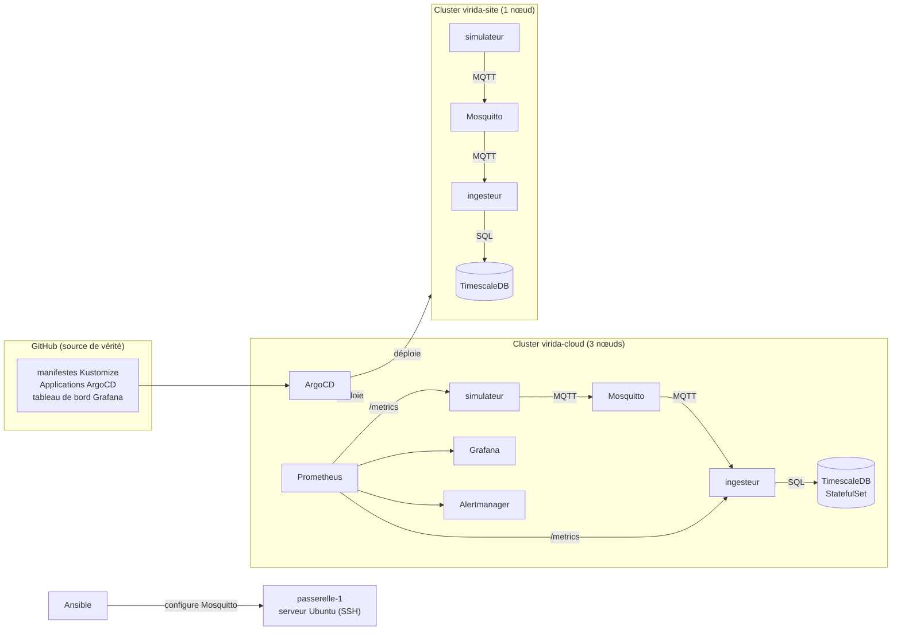

# Virida Fleet

Plateforme IoT de supervision de serres, déployée en **GitOps** sur deux clusters Kubernetes : un environnement **cloud** et un **site client**. Projet personnel d'apprentissage, construit étape par étape en novembre 2026 pour pratiquer Kustomize, ArgoCD, Ansible, Prometheus et Grafana.

Tout tourne en local, sur deux clusters [kind](https://kind.sigs.k8s.io/). Les capteurs sont simulés.

## Architecture



Un **simulateur** (Go) produit les mesures de 3 serres (température, humidité, pH), et les publie sur **Mosquitto** (MQTT). Un **ingesteur** (Go) s'y abonne et les range dans **TimescaleDB**. Un seul **ArgoCD**, installé dans le cluster cloud, déploie les deux sites depuis ce dépôt.

## Ce que le projet met en œuvre

| Domaine | Mise en œuvre |
|---|---|
| **GitOps** | ArgoCD : une instance pour deux clusters, synchronisation automatique, auto-réparation (`selfHeal`), suppression (`prune`), retour arrière par `git revert` |
| **Kustomize** | Une base commune et deux overlays (`cloud`, `site-client`) : namespace, étiquettes, patch de ressources, `configMapGenerator` par environnement |
| **Secrets** | [Sealed Secrets](https://github.com/bitnami-labs/sealed-secrets) : un mot de passe de base de données différent par site, chiffré, publiable dans ce dépôt public |
| **Données** | TimescaleDB en StatefulSet avec volume persistant, hypertable `mesures`, insertion idempotente (`ON CONFLICT DO NOTHING`) |
| **Fiabilité** | Sondes `readiness` et `liveness` séparées, attente de la base au démarrage, délais sur les appels réseau, arrêt propre sur `SIGTERM`, réabonnement MQTT à chaque reconnexion |
| **Supervision** | kube-prometheus-stack installé par ArgoCD, métriques métier exposées sur `/metrics`, `PodMonitor`, tableau de bord Grafana versionné dans Git, trois alertes (`PrometheusRule`) |
| **Conteneurs** | Un Dockerfile multi-étapes pour deux programmes (`ARG PROGRAMME`), images distroless non-root de 25 à 33 Mo, binaire statique (`CGO_ENABLED=0`) |
| **Ansible** | Playbook idempotent qui configure un broker Mosquitto sur un serveur Ubuntu : paquets, modèle Jinja2, handler de redémarrage |
| **Edge** | Un nœud edge relié au centre par un tunnel **WireGuard sortant**, un cluster **K3s** par-dessus, et des pannes provoquées et mesurées (voir [Partie edge](#partie-edge--k3s-et-wireguard)) |

## Organisation du dépôt

```
cmd/
  simulateur/        programme Go : génère et publie les mesures
  ingesteur/         programme Go : reçoit les mesures et les insère en base
Dockerfile           build commun, programme choisi par --build-arg PROGRAMME
k8s/
  base/              manifestes communs : simulateur, Mosquitto, TimescaleDB, ingesteur
  overlays/
    cloud/           namespace virida-cloud, secret scellé, PodMonitor, alertes
    site-client/     namespace site-client, secret scellé, ressources réduites
    edge/            namespace virida-edge : capteur et broker seulement, placement des pods
  supervision/       tableau de bord Grafana (ConfigMap générée)
argocd/              Applications ArgoCD : simulateur-cloud, simulateur-site,
                     supervision, tableaux-de-bord
ansible/             inventaire, playbook Mosquitto, image du serveur de test
edge/                image du nœud WireGuard ; edge/secrets/ (clés, non versionné)
kind-cloud.yaml      cluster cloud : 1 control-plane, 2 workers
kind-site.yaml       cluster site : 1 nœud
```

## Démarrer le laboratoire

Prérequis : Docker, [kind](https://kind.sigs.k8s.io/), kubectl, Helm, la CLI `argocd` et `kubeseal`.

```bash
# 1. Les deux clusters
kind create cluster -n virida-cloud --config kind-cloud.yaml
kind create cluster -n virida-site  --config kind-site.yaml

# 2. Les images, chargées dans les deux clusters
docker build --build-arg PROGRAMME=simulateur -t virida-simulateur:0.6.0 .
docker build --build-arg PROGRAMME=ingesteur  -t virida-ingesteur:0.4.0 .
for c in virida-cloud virida-site; do
  kind load docker-image virida-simulateur:0.6.0 virida-ingesteur:0.4.0 -n $c
done

# 3. ArgoCD (cluster cloud) et Sealed Secrets (les deux clusters)
helm repo add argo https://argoproj.github.io/argo-helm
helm install argocd argo/argo-cd -n argocd --create-namespace --kube-context kind-virida-cloud
for c in kind-virida-cloud kind-virida-site; do
  kubectl --context $c apply -f https://github.com/bitnami-labs/sealed-secrets/releases/download/v0.41.2/controller.yaml
done

# 4. Les Applications : ArgoCD déploie ensuite tout le reste
kubectl --context kind-virida-cloud apply -f argocd/
```

Le cluster site doit aussi être enregistré dans ArgoCD (`argocd cluster add`). Comme les clés de Sealed Secrets sont propres à chaque cluster, les secrets scellés de ce dépôt ne s'ouvrent que dans les clusters d'origine : sur un nouveau cluster, il faut les sceller à nouveau avec `kubeseal`.

## Incidents rencontrés

Ce projet m'a surtout appris à diagnostiquer. Quelques problèmes réels, et leur cause :

- **Le DNS ne fonctionnait plus dans le cluster site.** En remontant les couches : un nom de service introuvable, puis CoreDNS qui ne joignait plus l'API, puis kube-proxy en `CrashLoopBackOff` (« too many open files »). Cause : la limite `inotify` de l'hôte, atteinte avec deux clusters kind. Corrigée par `sysctl`, de façon permanente.
- **Un ingesteur « vert », mais qui ne recevait plus rien.** Après une reconnexion MQTT avec une session propre, le broker avait oublié l'abonnement. Corrigé en s'abonnant à chaque connexion, et rendu visible par une métrique de fraîcheur des données et une alerte.
- **Un `Ping` qui bloquait indéfiniment** quand la base était absente, au lieu d'échouer. Corrigé par un délai maximal sur chaque appel réseau (`context.WithTimeout`).
- **Des réglages de sécurité ignorés en silence** : un `securityContext` placé au niveau du pod au lieu du conteneur, dont Kubernetes ignorait deux champs.
- **Un cluster injoignable après un redémarrage** : son adresse IP avait changé. Résolu en visant le cluster par son nom DNS côté ArgoCD, et par le port publié côté poste de travail. Les Applications, qui visaient déjà le cluster par son nom, n'ont pas eu à changer.

## Limites connues

- Les capteurs sont **simulés** : aucun matériel réel.
- Prometheus n'est installé que dans le cluster cloud : les métriques du site client ne sont pas collectées. Il faudrait un Prometheus sur place qui envoie ses données au cloud (*remote write*).
- Les alertes sont chargées et évaluées, mais n'ont **pas encore été testées par une panne provoquée**, et aucun destinataire n'est configuré dans l'Alertmanager.
- Les images sont chargées dans les clusters avec `kind load` : il n'y a ni registre, ni chaîne CI.
- ArgoCD a tous les droits sur le cluster site ; en production, on les limiterait aux namespaces qu'il gère.

## Partie edge : K3s et WireGuard

Une extension du projet vers l'*edge* : un nœud installé chez un client (la serre) se connecte au centre par un **tunnel WireGuard sortant**, et un cluster **K3s** tourne par-dessus. Tout le trafic entre les nœuds passe dans le tunnel, chiffré. Le but : provoquer des pannes réalistes (changement d'adresse IP, perte du nœud) et **mesurer** comment le système réagit.

Tout tourne dans Docker, sur un réseau qui joue le rôle d'Internet.

```
                 réseau Docker « virida-wan » (172.30.0.0/24) = Internet simulé
┌──────────────────────────────┐                       ┌──────────────────────────────┐
│ edge-centre    172.30.0.10   │ ◄──── tunnel ──────── │ edge-serre1    172.30.0.21   │
│ wg0 = 10.200.0.1             │   WireGuard SORTANT   │ wg0 = 10.200.0.2             │
│ └ K3s serveur « centre »     │   (la serre appelle)  │ └ K3s agent « serre-1 »      │
│   Mosquitto                  │                       │   simulateur                 │
└──────────────────────────────┘                       └──────────────────────────────┘
```

**Les choix de conception :**
- **La serre appelle, le centre attend.** Seule la serre connaît l'adresse du centre (`Endpoint`) : le centre apprend celle de la serre au premier paquet authentifié. Une liaison sortante traverse le NAT d'une box sans ouvrir de port chez le client.
- **Kubernetes parle aux adresses du tunnel** (`--node-ip`, `--flannel-iface wg0`) : elles sont chiffrées et **stables**, même quand l'adresse « Internet » de la serre change.
- **Un conteneur WireGuard porte le réseau, le conteneur K3s s'y branche** (`--network container:...`) : la même image WireGuard sert pour tous les nœuds, et les clés sont montées à part, jamais copiées dans l'image.
- **Placement** : Mosquitto est fixé au centre (`nodeSelector`) ; le simulateur va **de préférence** sur la serre (affinité préférée), pour pouvoir partir ailleurs si elle tombe, avec une tolérance réduite à 20 s.

### Démarrer

Prérequis : le module noyau WireGuard (`sudo modprobe wireguard`) et `wireguard-tools`. Les clés, les configurations WireGuard et le jeton K3s se créent dans `edge/secrets/`, qui **n'est pas versionné**.

```bash
# 1. Image, réseau et clés
docker build -t virida-wg-node -f edge/Dockerfile.wg edge/
docker network create --subnet 172.30.0.0/24 virida-wan
cd edge/secrets
wg genkey | tee centre.key | wg pubkey > centre.pub
wg genkey | tee serre-1.key | wg pubkey > serre-1.pub
openssl rand -hex 16 > k3s-token
cd ../..
# puis écrire edge/secrets/centre-wg0.conf et edge/secrets/serre-1-wg0.conf

# 2. Les deux nœuds WireGuard
docker run -d --name edge-centre --cap-add NET_ADMIN --network virida-wan --ip 172.30.0.10 \
  -v $PWD/edge/secrets/centre-wg0.conf:/etc/wireguard/wg0.conf:ro virida-wg-node
docker run -d --name edge-serre1 --cap-add NET_ADMIN --network virida-wan --ip 172.30.0.21 \
  -v $PWD/edge/secrets/serre-1-wg0.conf:/etc/wireguard/wg0.conf:ro virida-wg-node

# 3. K3s : le serveur au centre, l'agent sur la serre, tous deux dans le réseau du tunnel
docker run -d --name edge-k3s-centre --privileged --network container:edge-centre \
  --tmpfs /run --tmpfs /var/run -e K3S_TOKEN=$(cat edge/secrets/k3s-token) \
  rancher/k3s:v1.31.4-k3s1 server --node-name centre --node-ip 10.200.0.1 \
  --advertise-address 10.200.0.1 --flannel-iface wg0 --disable traefik --disable metrics-server
docker run -d --name edge-k3s-serre1 --privileged --network container:edge-serre1 \
  --tmpfs /run --tmpfs /var/run -e K3S_TOKEN=$(cat edge/secrets/k3s-token) \
  -e K3S_URL=https://10.200.0.1:6443 \
  rancher/k3s:v1.31.4-k3s1 agent --node-name serre-1 --node-ip 10.200.0.2 --flannel-iface wg0

# 4. L'image du simulateur sur les deux nœuds (pas de registre), puis l'overlay edge
for n in edge-k3s-centre edge-k3s-serre1; do
  docker save virida-simulateur:0.6.0 | docker exec -i $n ctr images import -
done
kubectl kustomize k8s/overlays/edge | docker exec -i edge-k3s-centre kubectl apply -f -
```

### Mesures

| Essai | Résultat mesuré |
|---|---|
| Changement d'IP de la serre, keepalive 25 s | **14, 15, 14 s** de coupure (3 essais) |
| Changement d'IP de la serre, keepalive 10 s | **8, 8, 9 s** de coupure (3 essais) |
| Changement d'IP vu par Kubernetes | le nœud `serre-1` reste **`Ready`** |
| Perte du nœud `serre-1` | simulateur recréé sur le centre en **60 à 70 s** |

La coupure est mesurée par une sonde qui pingue la serre depuis le centre chaque seconde : durée = dernier échec moins premier échec.

### Ce que les mesures ont appris

- **La théorie disait 25 s, la mesure a donné 15 s.** Avec un keepalive de 25 s, le tunnel revient en fait par un mécanisme interne de WireGuard : sans réponse quelques secondes après un envoi, la serre relance d'elle-même une poignée de main. Avec 10 s, c'est le keepalive qui joue. Le réglage est un compromis entre le temps de rétablissement et le trafic permanent (coûteux en 4G, et multiplié par le nombre de nœuds).
- **Kubernetes ne voit pas un changement d'IP** : la coupure du tunnel (moins de 15 s) est plus courte que le délai au bout duquel il déclare un nœud perdu (environ 40 s).
- **Le « faux mort »** : après la perte du nœud, l'ancien pod reste en `Terminating`, car Kubernetes ne peut pas confirmer qu'il est arrêté. Si seul le réseau était coupé, deux simulateurs tourneraient en même temps : d'où l'intérêt de messages idempotents (identifiant unique et `ON CONFLICT DO NOTHING` côté ingesteur).
- **Le placement est décidé à la création** (`IgnoredDuringExecution`) : quand la serre revient, le simulateur reste au centre jusqu'à ce qu'il soit recréé.

### Limites de la partie edge

- **Un seul nœud edge**, simulé dans Docker, sans vraie box ni vrai NAT entre les deux.
- Le tunnel est chiffré et authentifié par clé, mais ce n'est **pas du zero-trust** : pas d'identité par requête, et **pas d'attestation** du nœud (TPM).
- Les clés WireGuard sont générées et distribuées à la main ; pour une flotte, il faudrait une gestion centralisée.
- Les images sont importées à la main sur chaque nœud, sans registre.
- La partie edge n'est pas encore pilotée par ArgoCD.
